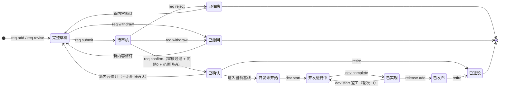

# reqledger 参考手册

配套 [SKILL.md](SKILL.md) 使用。命令与字段的**唯一权威**始终是 `reqledger <family> <action> --help`；本文件是地图与提示，不替代帮助。

## 1. 命令地图（门禁摘要）

| 命令 | 类型 | 通过条件 / 作用 |
| --- | --- | --- |
| `init` | 写入 | 文件不存在且 `expected_revision=0`；创建空台账，绝不覆盖 |
| `show` | 只读 | 任意有效历史；返回完整机器状态 |
| `query` | 只读 | `working` / 指定 `id+revision` / `active` / `baseline+baseline_id` |
| `history` | 只读 | 对象原修订与相关原事件，不改状态 |
| `diff` | 只读 | 递归比较需求修订或基线的具体字段/范围 |
| `check` | 只读 | 结构校验；覆盖缺口≠结构损坏，不自动修复 |
| `recover` | 恢复检查 | 按 `operation_id` 判定 committed / not_committed / unknown |
| `page add` / `page revise` | 写入 | 新页面修订 1；revise 需 `base_revision` 为最新且未退役 |
| `source add` / `source revise` | 写入 | 同上；保存原话、摘录、定位 |
| `req add` / `req revise` | 写入 | 完整字段通过后新建完整草稿；revise 不沿用旧确认 |
| `req submit` | 写入 | 最新完整草稿 → 待审核；不能重提已拒绝/已撤回 |
| `req confirm` | 写入 | 最新待审核 + 最新精确审核通过 + 开放问题为 0 + 范围明确 |
| `req reject` | 写入 | 最新待审核 + 最新审核不通过 |
| `req withdraw` | 写入 | 完整草稿/待审核可有原因撤回；**不能撤回已确认承诺** |
| `review add` | 写入 | 对精确修订/摘要追加声明审核；不自动确认、批准或激活 |
| `baseline seal` | 写入 | 成员精确已确认、范围明确、纳入依赖闭合无环；前驱当前 |
| `baseline activate` | 写入 | 候选未激活、前驱仍当前、最新基线审核通过、冻结引用未退役 |
| `baseline void` | 写入 | 仅未激活且未作废候选 |
| `change propose` | 写入 | 已激活前驱 + 合法精确差异 → 已提出 |
| `change revise` | 写入 | 应用前未关闭且 `base_revision` 最新 → 新修订，重评重审 |
| `change evaluate` | 写入 | 已提出首次评估；后续改评估须先修订 |
| `change approve` | 写入 | 已评估 + 最新精确审核通过 |
| `change apply` | 写入 | 已批准 + 审核通过 + 前驱当前 + 冻结引用有效 → 候选基线（不自动激活） |
| `change reject` / `change cancel` | 写入 | 拒绝 / 应用前直接关闭，不改变承诺 |
| `change close` | 写入 | 已应用候选须已激活或作废，再逐动作逐义务关闭 |
| `dev start` | 写入 | 未开始/已实现 → 进行中；首次轮次 1，返工带 `reason` 且轮次 +1 |
| `dev complete` | 写入 | 进行中 → 已实现，轮次不变 |
| `acceptance record` | 写入 | 曾激活基线成员 + 对应轮次已实现；通过/不通过/批准不适用 |
| `acceptance waive` | 写入 | 预先 `allow_na=true` + 对应已实现轮次；只追加免验确认 |
| `release add` | 写入 | 当前基线成员 + 当前已实现轮次 + 本交付全条件通过 + 重验有效 → 不可变登记 |
| `retire` | 写入 | 对象未退役、无当前基线引用、无纳入活动依赖；只追加历史 |

## 2. 状态机



内容状态、开发态、发布标记、退役标记**互不覆盖**：同一需求可有多修订、多轮次、多次发布。

### 2.1 状态转换的目标引用

`req submit` / `req confirm` / `req reject` / `req withdraw` 的 `data` 需要精确目标引用：

```json
{"id":"REQ-000001","revision":1,"digest":"<show 返回的真实摘要>"}
```

`confirm` 另需 `scope.decision`（`纳入` / `排除` / `延期`）；排除或延期必须给 `scope.reason`；待决定或存在未回答问题不能确认。

## 3. 需求字段（`req add` / `req revise` 的 `data`）

必填（缺一即 INPUT 2）：

| 字段 | 说明 |
| --- | --- |
| `title`、`description` | 标题与自然语言说明（禁止纯 JSON/代码块/占位符） |
| `purpose`、`necessity` | 目的；删除本项会出现什么管理缺口 |
| `type` | `功能` / `非功能` / `范围边界` |
| `module`、`priority` | 模块名；`P0` / `P1` / `P2` |
| `placement` | `kind=页面` 时绑定 `primary.page_id` + `page_revision`（`region_id` 省略/null 表示整页）；全局或非页面须在 `reason` 说明 |
| `sources` | 至少一项精确来源修订：`[{source_id, source_revision}]` |
| `included` | 非空数组：本需求包含什么 |
| `excluded`、`boundaries` | 排除项与边界；可写 `{not_applicable:true, reason:...}` |
| `normal_behavior` | 正常场景、行为与可观察预期 |
| `acceptance` | 验收条件数组（见下） |
| `questions` | 未决问题列表：`{question, proposal, answer}`，未答为 `null` |

可选/自动：`dependencies`、`tags`（省略即空集合）、`technical`（文字补充）。**ID、状态、修订、时间、摘要一律由脚本生成，禁止手填。**

## 4. 验收条件字段（`acceptance[]`）

`role`、`scenario`、`preconditions`、`input`、`operation`、`expected`、`exception`（`scenario`+`expected`+`handling`）、`method`、`evidence` 全部必填；仅 `preconditions`/`input`/`exception` 允许显式不适用（`{not_applicable:true, reason:...}`）；`allow_na` 默认 `false`，只有预先声明才可免验。

## 5. 审核字段（`review add` 的 `data`）

```json
{"target_type":"requirement","target_id":"REQ-000001","target_revision":1,
 "target_digest":"<该修订冻结摘要>",
 "conclusion":"通过","necessity_review":"…","completeness_review":"…",
 "acceptance_review":"…","basis":"…"}
```

`target_type` 可为需求或基线；审核只记录声明与依据，不认证独立身份。

## 6. 变更、发布、退役要点

- 变更 `actions` 表达精确差异（`新增`/`修改`/`移除` 等，以 `--help` 为准），并带 `predecessor` 与 `impact_objects`。
- `change apply` 只生成**候选**基线；必须 `baseline activate` 后才生效，再 `change close` 逐动作、逐义务关闭。
- 未关闭义务会阻断后续 `release add`。
- `release add` 冻结 `baseline_id`、`delivery_id` 与各成员 `cycle`；旧发布不因后续失败被改写。
- `retire` 不删除、不可恢复启用；退役后禁止新绑定、新修订与依赖引用。

## 7. `query` 过滤字段

`type`（requirements/pages/sources）、`id` + `revision`、`view`（working/active/baseline）、`baseline_id`、`page_id`/`page_revision`/`region_id`、`source_id`/`source_revision`、`module`、`tags`（数组，全部匹配）、`scope`、`status`、`agent`、`time_from`/`time_to`（显式时区）、`retired`、`trace`。全部按 AND 组合。

## 8. 可复制样例（来自 `--help`，须替换真实内容）

初始化：

```json
{"operation_id":"init-001","agent":"agent-a","reason":"建立需求台账","expected_revision":0,"data":{"name":"示例项目"}}
```

页面：

```json
{"operation_id":"page-add-001","agent":"agent-a","reason":"登记明确资料","expected_revision":1,
 "data":{"name":"需求列表页","location":"设计稿第1页","regions":[{"name":"筛选区","locator":"页面顶部筛选表单"}]}}
```

来源：

```json
{"operation_id":"source-add-001","agent":"agent-a","reason":"登记明确资料","expected_revision":1,
 "data":{"kind":"人工记录","name":"用户需求访谈","quote":"列表需要按模块筛选。","summary":"原话表达了按模块定位需求的意图，具体边界仍需审核。","manual_note":"用户在本次访谈中提供的原话","date_note":"2026-10-24用户消息"}}
```

开发开始 / 返工：

```json
{"operation_id":"dev-start-001","agent":"agent-a","reason":"明确记录开始或实现依据，返工说明原因","expected_revision":9,
 "data":{"baseline_id":"BASE-000001","id":"REQ-000001","revision":1,"digest":"<冻结摘要>"}}
```

逐条件验收：

```json
{"operation_id":"acceptance-record-001","agent":"agent-a","reason":"记录实际验证依据或具体免验原因","expected_revision":10,
 "data":{"baseline_id":"BASE-000001","requirement_id":"REQ-000001","revision":1,"cycle":1,"condition_id":"AC-000001","delivery_id":"delivery-one","result":"通过","actual":"实际返回403，拒绝无权限请求。","method":"核对合成响应状态及拒绝文案。","evidence":"合成响应记录第1条","implemented_event_id":"EVT-000010"}}
```

发布：

```json
{"operation_id":"release-add-001","agent":"agent-a","reason":"按逐项证据登记本次交付","expected_revision":13,
 "data":{"baseline_id":"BASE-000001","delivery_id":"delivery-one","members":[{"id":"REQ-000001","revision":1,"cycle":1}]}}
```

退役：

```json
{"operation_id":"retire-001","agent":"agent-a","reason":"该对象已退出当前承诺，保留历史追溯","expected_revision":20,
 "data":{"type":"requirement","id":"REQ-000001"}}
```

## 9. 故障排查

| 现象 | 真实原因 | 处理 |
| --- | --- | --- |
| `INPUT` 且 `field=input.data.xxx` | 字段缺失/占位符/非法枚举 | 按 `issues` 逐项补齐，用 `--help` 的字段规则 |
| `GATE` 提示未确认/未审核 | 跳过 review 或 confirm | 先 `req submit` → `review add` → `req confirm` |
| `CONFLICT` 且提示修订不符 | `expected_revision` 过期 | `show` 取最新文档修订后重算 |
| `CONFLICT` 且提示操作冲突 | 同 `operation_id` 异载荷 | 换新 ID；原 ID 只用于重放同一操作 |
| `BUSY` | 有存活进程持锁 | 等待退出，`recover` 查状态；**不要删锁文件** |
| `IO` | 父目录不存在/权限/文件系统不支持 | 换本地固定盘或修权限 |
| `CORRUPT`/`UNKNOWN` | MD 被手改、字节损坏或提交未知 | 保留字节，`check` + `recover`，不要覆盖写 |
| `recover` 返回 `unknown` | 权威 MD 不可验证 | 人工核对备份，禁止用临时文件覆盖 |

## 10. 平台与限制

- Python >= 3.11；单文件标准库；`pytest`（开发）与 `build`（构建）不是运行依赖。
- 台账目录：Windows 本地固定 NTFS、Linux 本地 ext4；macOS 使用同一 `fcntl` 实现并由 CI 实测。
- 不支持 UNC/网络共享、已知云同步目录、多硬链接台账、多主机并发；不承诺断电绝对耐久。
- 同一目录的 `.<name>.lock` 是锁载体，不是第二业务文档。
